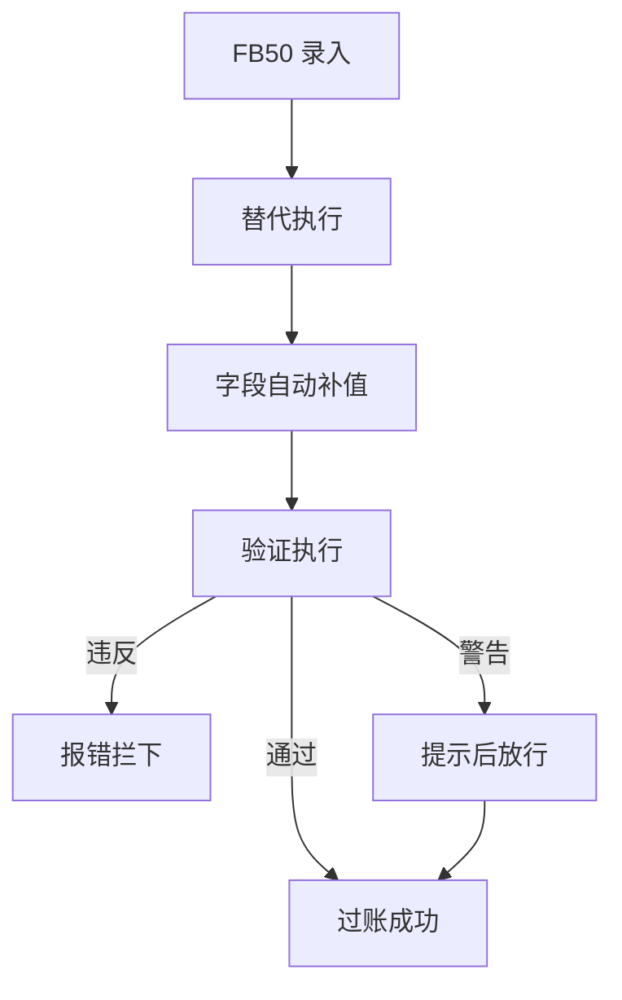

## 一句话结论

> 验证（`GGB0`）管「拦不拦」：过账前检查字段，违反则报错或警告；替代（`OBBH`）管「改成什么」：过账前自动补值或改写字段——过账被莫名消息拦下先想有人在加验证，字段值莫名变了先想替代在生效，两者都要激活到公司代码才起作用。

## 症状

- 用户 `FB50` 过账被一条自定义消息拦下，消息文本一看就是内部规则（如「费用类科目必须输成本中心」），但没人知道是谁配的。
- 过账前明明输了成本中心，`FB03` 里看到的却是另一个值——字段被悄悄改掉了。
- 运输上线后规则时灵时不灵：A 公司代码拦截、B 公司代码放行，同一家集团行为不一致。

## 根因（按概率）

| 根因（按概率） | 验证动作 | 修复动作 |
|---|---|---|
| 新增验证未同步通知业务 | `GGB4` 看激活的公司代码与规则清单 | 确认规则合理性，调整先决条件或补培训 |
| 验证先决条件过宽，误伤正常凭证 | `GGB0` 逐步骤读先决条件布尔式 | 收窄到公司代码 1000 + 特定科目区间 |
| 替代覆盖了用户手工值 | `OBBH` 看替代字段与先决条件 | 把需保留手工输入的字段移出替代清单 |
| 规则未激活到该公司代码 | `GGB4`/`OBBH` 查激活级别是否含 1000 | 按公司代码激活并重测 |
| 出口例程未注册或传输后未再生 | 检查出口程序状态与生成日志 | 注册/重新生成（事务以系统为准） |

## 配错会怎样

- 验证误拦：正常业务凭证大面积过不了账，月结当天排队救火。
- 验证漏拦：该拦的没拦（如利润中心与公司代码不匹配），错数据进账后只能逐笔调整。
- 替代写错字段：分配号/成本中心被批量改错，CO 报表口径整体漂移，回头整月冲重。

## 怎么配置

1. **定义验证（`GGB0`）**：应用区 FI 下选调用点——凭证抬头 / 行项目 / 完整凭证；每条规则三段：先决条件（什么时候管）→ 检查（必须为真的断言）→ 报错消息（消息类/号，E 拦下或 W 提示）。
2. **激活验证（`GGB4`）**：选中验证集，设激活级别并挂公司代码 1000——未激活的规则只是摆设；激活后先在测试系统造正反两笔凭证再上生产。
3. **定义替代（`OBBH`）**：同样按调用点组织，规则三段：先决条件 → 替代（目标字段）→ 字段值（常量或出口例程派生）。
4. **激活替代**：替代的激活在其配置事务内按公司代码完成（级别含义与验证一致，以系统为准）。
5. **执行顺序口径**：常见文档口径是同一调用点上先执行替代、再执行验证（替代补出的值随后被验证检查），但不同调用点与版本存在差异——具体顺序以你的系统与官方文档为准。
6. **出口前提**：用自定义出口做复杂派生时，出口例程须先在系统里注册/激活才能被规则引用（相关事务与程序以系统为准）。

## 参数与组合全解

### 验证三段结构

| 段 | 管什么 | 典型写法（示意） |
|---|---|---|
| 先决条件 | 规则对哪些行生效 | 公司代码 = 1000 且科目在费用区间 |
| 检查 | 必须为真的断言 | 成本中心非空；利润中心属于本公司代码 |
| 报错消息 | 违反时的反馈 | 消息类 + 号 + 变量（E 拦 / W 提示） |

### 替代三段结构

| 段 | 管什么 | 典型写法（示意） |
|---|---|---|
| 先决条件 | 何时替代 | 公司代码 = 1000 且科目为费用类 |
| 替代 | 改哪个字段 | 成本中心 / 分配号 |
| 字段值 | 填什么 | 常量；或出口按部门派生 |

### GGB4 激活级别（示意，含义以系统为准）

| 级别 | 生效范围 | 使用建议 |
|---|---|---|
| 0 | 未激活 | 停用观察期 |
| 1 | 指定公司代码 | 生产推荐：按公司代码灰度 |
| 2 | 客户端全部公司代码 | 集团统一规则 |

### 调用点与典型规则

| 调用点 | 对象 | 典型规则 |
|---|---|---|
| 凭证抬头 | 抬头字段 | 抬头文本/参照格式校验 |
| 行项目 | 单行字段 | 成本中心必填；利润中心与公司代码匹配 |
| 完整凭证 | 跨行整体 | 借贷方维度一致性检查 |

## 边缘与高级场景

- **替代与手工值的优先级**：替代在用户录入之后执行，被替代字段的最终值就是替代结果——手工值被覆盖是机制不是故障；想保留手工输入，把该字段移出替代清单或收窄先决条件。字段能不能输由字段状态组管（见[字段状态组](/03-config-notes/gl-field-status)），输完后改成什么由替代管，两层别打架。
- **验证消息的警告放行**：消息定为 E 则硬拦、W 则提示后可继续；部分消息严重度可经消息控制（`OBA5` 口径）调整，作用范围以你的系统为准——新规则上线先设 W 观察一个期间再转 E 是稳妥路径。
- **增强与标准验证的边界**：简单布尔判断用验证/替代（业务读得懂、随请求传输）；复杂逻辑（查自定义表、调外部系统）走出口例程或增强点——同一规则别在验证和增强里各写一份，排错时两处都要翻。
- **凭证类型级差异**：规则只应作用于特定凭证类型时，把凭证类型写进先决条件，别依赖用户的记账习惯兜底。

## 怎么验证

公司代码 1000，`FB50` 造两笔凭证：一笔费用行不输成本中心（应触发验证）；一笔随意输成本中心但命中替代先决条件。

**验证 T-Code**：`FB50`
**验证判据**：第一笔保存即被验证消息拦下（E 类），消息文本与 `GGB0` 定义一致；第二笔过账成功后 `FB03` 查行项目，分配号/成本中心 = 替代规则派生值而非手工输入值。
**失败对照**：规则完全不生效 → `GGB4`/`OBBH` 查激活级别是否覆盖 1000；字段没被替代 → 先决条件未命中或字段不在替代清单；被莫名消息拦 → 按消息类/号反查 `GGB0`；相关报错场景见[报错速查](/01-daily-ops/errors/)。

## 相关 T-Code

`GGB0` · `GGB4` · `OBBH` · `FB50`
