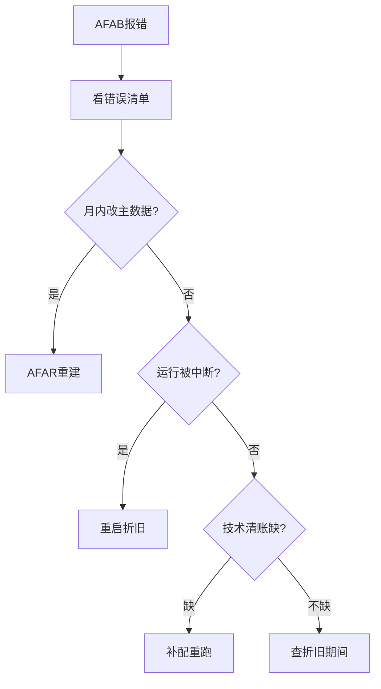

# 排查实战 06 — AFAB 折旧跑不动：从错误清单到技术清账

> 月结卡在 `AFAB`，别一头扎进总账硬对。先读错误清单，再做 S/4 特有的「`AFAR` 重建 → `AFAB` 测试」两段式恢复，口径见 [S/4 新资产会计笔记](/03-config-notes/asset-s4-diff)。

## 报错现场

周四晚 11 月月结，财务在 `AFAB`（S/4HANA，公司代码 1000，期间 011）跑正式折旧运行中断，报「余额存在差异」类错误（消息号以你的系统为准）。再进 `AFAB` 提示：该期间折旧运行未完成。错误清单列了 20 个资产，全部来自 100001 新号段。

刚做了什么：10 月中旬上线一批新资产；11 月初在 `AS02` 集中补改过折旧码与资本化日期。

## 第一步：读懂消息

「余额存在差异」不是让你对总账——它指资产明细过账值与运行要写的值对不上，运行被中止保护数据。第一入口不是 `FB03`，而是错误清单：每行一个资产，点开看差异描述（以你的系统为准）。20 个、全部新号段——清单就是圈定对象的输入。速查口径见 [AFAB 折旧报错](/01-daily-ops/errors/afab-depreciation-error)。

## 第二步：圈定排查对象

共同点：10 月新建、当月购置、11 月初改过主数据。S/4 下明细并入 `ACDOCA`，主数据变更后需重建折旧，计划值与明细才一致——不再是 ECC「改完即生效」。对象三层：当期数据 → 主数据参数 → 重建机制与配置。

## 第三步：三层排查

### 数据层

**查什么**：抽 3 个资产，`AW01N` 看购置值与已过账折旧：11 月有无新购置、折旧是否部分过账、有无手工调账。
**预期**：购置在 10 月完成、11 月无新增购置、无手工调整；「计划折旧」与「已过账」两列不一致。
**异常说明什么**：11 月有新购置 → 属新增折旧，不该报差异，先查购置流程；有手工调账 → 先停下查操作人，绕过折旧引擎是 S/4 大忌。本例数据层干净，不一致集中在「计划值未刷新」，指向未重建。

### 主数据层

**查什么**：`AS02` 逐项看这批资产：折旧码、使用年限、资本化日期、停用标记。
**预期**：折旧码有效、使用年限合理、资本化日期合法、无停用。
**异常说明什么**：折旧码失效 → 计算直接出错，修参数即可；资本化日期改到未来 → 当期折旧为零或负。本例参数合法——问题不在「值是多少」，而在「改了之后没重算」。「11 月初集中变更」与错误时间高度相关，正是下一层的方向。

### 配置层

**查什么**：两个方向：其一，`AFAR` 重建——改主数据后折旧范围有没有重建（S/4 通常自动触发，批量场景会漏，以你的系统为准）；其二，技术清账科目配置是否完整、有无挂账。
**预期**：变更后折旧范围已重建；技术清账科目完整且各笔已清。
**异常说明什么**：重建缺失 → `AFAB` 拿旧计划对 `ACDOCA` 明细，必然中断；技术清账科目缺失 → 错误清单出现科目类提示，且 10 月购置就会报错——本例购置全部成功，反证它没问题。实测：20 个资产重建状态异常，坐实「变更后未重建」。机制详见 [S/4 新资产会计笔记](/03-config-notes/asset-s4-diff)。

## 根因（按概率）

| 根因（按概率） | 验证动作 | 修复动作 |
|---|---|---|
| 1. 期间内改主数据后未重建（高频） | `AFAR` 重建后对比计划值 | 重建 → `AFAB` 测试 → 正式 |
| 2. 运行中断后状态卡住 | `AFAB` 首屏看运行状态 | 按提示重启或完成会话 |
| 3. S/4 技术清账科目缺失或未清 | `FAGLL03` 查技术科目余额 | 补配并跑通购置链 |
| 4. 折旧期间未开或涉及前期差异 | 查 `AFAB` 期间与期间控制 | 开当期折旧期间，前期走计划外折旧 |

## 真凶与修复

真凶：`AS02` 批量补改折旧码与资本化日期后，20 个资产的折旧范围未重建，`AFAB` 拿旧计划对明细，差异超限即中断。修复三步：`AFAR` 重建 → `AFAB` 测试、错误清单清零 → 正式运行补过折旧。S/4 下中断不必先整单撤销，重启即可（选项以你的系统为准）。预防：把「改主数据 → `AFAR` → 测试」固化成月结前固定顺序。

## 修复后验证

**验证 T-Code**：`AFAB`
**验证判据**：测试运行 0 错误；正式运行后重进 `AFAB` 提示无待过账折旧（文本以你的系统为准）；抽查 `AW01N` 已过账折旧 = 总账累计折旧当期发生额
**失败对照**：测试仍报错 → 按错误清单逐行处理，出现技术清账科目类提示就转查 S/4 配置，见 [新资产会计差异](/03-config-notes/asset-s4-diff)；提示运行未完成 → 按首屏状态走重启流程

## 举一反三

- 月结前先问「本月改过资产主数据吗」——改过就先 `AFAR` 再 `AFAB`，顺序反了白忙。
- S/4 下别用 ECC「先撤销再重跑」的直觉，`AFAB` 支持中断重启。
- 同系列见 [F5 开票 100 报错案](/04-troubleshooting/case-f5-100)：错误清单比猜测快。

