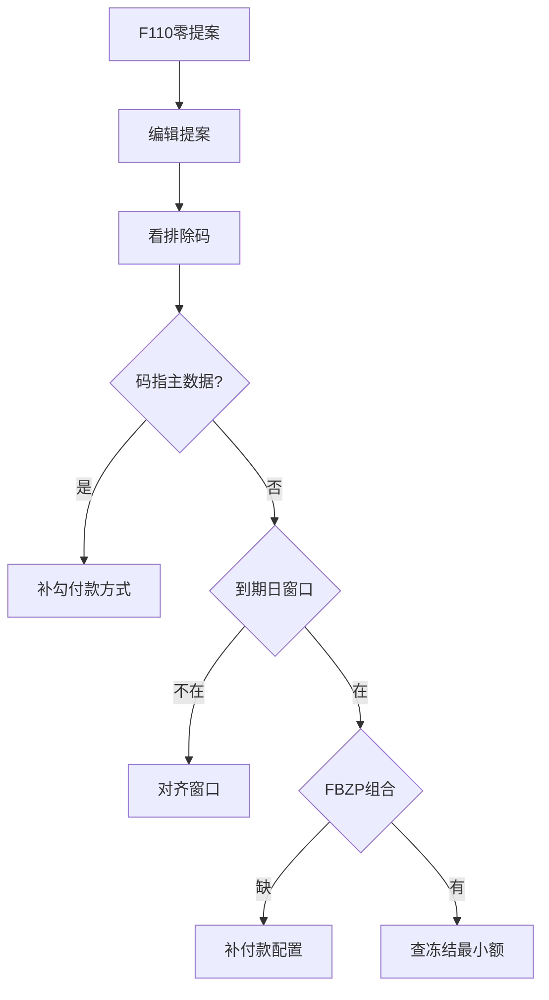

# 排查实战 05 — F110 零提案：从排除码反推主数据与 FBZP

> 「零提案 + 无报错」最容易被误判成系统故障。本案从提案的排除清单入手，让排除码替你缩小范围。配置口径见 [F110 自动付款笔记](/03-config-notes/ap-auto-payment)。

## 报错现场

周五 16:30，财务在 `F110` 跑完提案：公司代码 1000、付款方式 C（支票）、下一付款日明天。清单 0 行，日志无报错。财务来电：「系统坏了，这个月的支票付款全出不去。」

刚做了什么：本周起部分供应商从付款方式 T（转账）统一切到 C，主数据由业务批量改过——最大嫌疑背景。

## 第一步：读懂消息

本案特点是「没有消息」：`F110` 不报错只说明运行完成，不代表有发票符合条件——「谁没进来、为什么」写在提案的排除清单里：`F110` 环境菜单进「编辑提案」（双击运行标识），被排除的发票逐行带排除码（码值以你的系统为准）。排除码是系统写好的排查报告，每个码都指回主数据或配置点——先看它再查。速查口径见 [F110 付款运行无提案](/01-daily-ops/errors/f110-no-proposal)。

## 第二步：圈定排查对象

先确认「该有提案」的前提：`FBL1N` 查供应商 200001 的到期未清项——有 3 笔约定支票付款的发票，最早一笔上周就到期。前提成立，问题变成「`F110` 为什么看不见」。对象三层：到期窗口 → 支付交易视图 → `FBZP`（C × 1000 × CNY）。

## 第三步：三层排查

### 数据层

**查什么**：`FBL1N` 逐笔看这 3 张票的付款条件、基准日与到期日，对照「下一付款日」（明天）与「过账至日期」。
**预期**：到期日不晚于下一付款日才有资格进提案；3 笔中至少 2 笔上周到期，应满足。
**异常说明什么**：到期日全部晚于下一付款日 → 纯窗口问题，改参数或付款条件即可；过账至日期早于到期日同理。本例 2 笔明确在窗口内，窗口因素排除。

### 主数据层

**查什么**：支付交易视图（查询 `XK03`、维护 `XK02`，事务以你的系统为准），看 200001：付款方式是否含 C、银行数据是否完整。
**预期**：勾选 C 且银行明细可用。
**异常说明什么**：只勾了 T → 漏改主数据，`F110` 先按主数据过滤，这 3 张票进不了候选；银行数据空 → 勾了 C 也会因确定不了付款银行被排除。回看排除清单：这 3 行的排除码正指向「主数据付款方式/银行数据」一类——证据闭环；但仍要看配置层，确认 C 在 `FBZP` 里本来就通。

### 配置层

**查什么**：`FBZP` 逐层核对：国家层 C 是否定义、公司代码 1000 层是否启用 C、币种是否含 CNY、最小金额门槛；银行确定里「C + CNY + 银行」组合有无规则。
**预期**：C 在两层都存在，币种含 CNY，银行确定能选出付款账户。
**异常说明什么**：公司代码层没启用 C → 全部供应商都进不来，而本周 T 方式付款正常，反证 C 的链路通；CNY 不在允许币种 → 整批按币种排除。实测配置完整——真凶在主数据。配置树走法见 [FBZP 配置树](/03-config-notes/ap-auto-payment)。

## 根因（按概率）

| 根因（按概率） | 验证动作 | 修复动作 |
|---|---|---|
| 1. 供应商未勾该付款方式（高频） | 排除码 + `XK03` 支付交易视图 | `XK02` 补勾 C、维护银行数据 |
| 2. 到期日不在窗口 | `FBL1N` 到期日 vs 下一付款日 | 对齐参数窗口或修付款条件 |
| 3. `FBZP` 付款方式/币种组合未配 | `FBZP` 国家层与公司代码层 | 补齐组合并传输 |
| 4. 发票冻结或低于最小金额 | 排除码 + `FBZP` 门槛设置 | 解冻走审批，或调最小金额 |

## 真凶与修复

真凶：供应商 200001 的支付交易视图只维护了 T、没勾 C——批量切换时漏改主数据。修复：`XK02` 补勾 C 并核对银行数据（维护事务以你的系统为准）。两个提醒：主数据变更只影响之后的提案，本次提案需删除后重跑；把切换清单里其余供应商按同一视图过一遍，别只修来电话这家。

## 修复后验证

**验证 T-Code**：`F110`
**验证判据**：参数不变、删除旧提案重跑，提案行数 = `FBL1N` 同口径到期未清数（付款方式 C、到期日不晚于下一付款日、无冻结）；正式运行后这 3 笔变已清
**失败对照**：仍为零或行数偏少 → 重新编辑提案看排除码，按 [排除码口径](/01-daily-ops/errors/f110-no-proposal) 反查对应层；有提案但付款报错 → 回 [FBZP 配置树](/03-config-notes/ap-auto-payment) 查银行确定组合

## 举一反三

- 「零提案」永远先编辑提案看排除码，每个码都指回一个主数据或配置点。
- 批量切换付款方式前，把「主数据勾选 × `FBZP` 启用 × 币种」列进切换清单。
- 同系列见 [F5 开票 100 报错案](/04-troubleshooting/case-f5-100)：「无报错也要找证据」。

