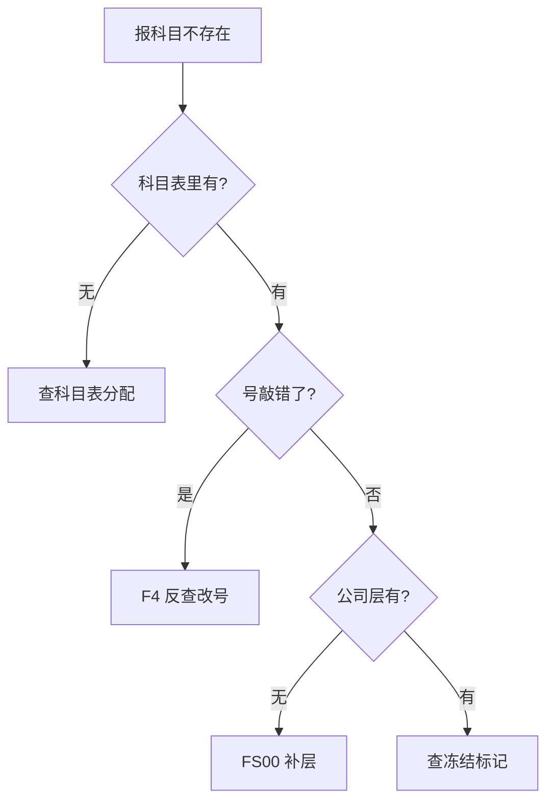

# 排查实战 01 — F5 100：从科目不存在到 FS00 科目层缺失

> 一句话：屏幕说「科目不存在」时，先分清是敲错了号、还是科目没扩展到公司代码 1000——三层下探，真凶多半在主数据层。方法论见[排查方法论](/04-troubleshooting/playbook-intro)。

## 报错现场

时间点：12 月 1 日下午，新公司代码 1000 上线后的第一个月结前。用户在 `FB50` 录一笔凭证：借方行科目敲 400000，回车，屏幕底部红条：

`G/L account 400000 in company code 1000 does not exist`（示意，消息号以你的系统为准）

用户电话原话：「400000 在科目清单里明明有，别的科目都能录，就它不行。」

## 第一步：读懂消息

状态栏消息的结构是「消息类 + 消息号 + 参数」。点红条上的长文本按钮看完整版，再做两件事：

1. 拆类与号：这是 `F5` 类 100 号。`SE91` 输类 `F5`、号 `100`，读官方长文档——系统在说「该科目在这个公司代码中不存在」，抱怨的是**科目×公司代码这个组合**，不是科目表整体。
2. 读参数替换：`&1`→400000（科目），`&2`→1000（公司代码）。问题被钉死在「400000 在 1000 的可用性」上。

速查版见[F5 100 报错条目](/01-daily-ops/errors/f5-100)；本篇多的是排查过程本身。

## 第二步：圈定排查对象

- 公司代码：默认公司代码确认为 1000，其他科目凭证正常——排除「全局坏了」。
- 科目：只有 400000 报错——不是凭证类型、权限或界面问题。

排查对象收敛为：**科目 400000 × 公司代码 1000**。

## 第三步：三层排查

### 数据层

- **查什么**：凭证行本身——科目号是不是敲错（0 敲成 O、丢前导零、串号）。
- **预期**：`F4` 按科目描述反查，应命中 400000 且描述与业务含义一致。
- **异常说明什么**：若反查发现应为 400010 之类，就是纯手误，改行收工。本例 `F4` 命中且一致——凭证数据无误，下探。

### 主数据层

- **查什么**：`FS00` 输 400000 + 公司代码 1000，看能否直接进入维护界面。
- **预期**：正常应直接进入中央科目维护，能看到科目表层与公司代码层数据。
- **异常说明什么**：本例 `FS00` 弹出「创建公司代码层数据？」提示；`FSP0`（只查科目表层）能正常进入——科目表层存在、公司代码层从未建过，正是「科目表里有、1000 没扩展」的经典场景。

### 配置层

- **查什么**：`OBD4` 核对公司代码 1000 分配的科目表（`OB13` 定义），排除科目表错配。
- **预期**：1000 挂在正确的科目表上。
- **异常说明什么**：若连 `FSP0` 都查无 400000，才回头查科目表分配。本例配置无误——漏的不是配置，是「扩展」这个主数据动作。

## 根因（按概率）

| 根因（按概率） | 验证动作 | 修复动作 |
|---|---|---|
| 1. 科目只建了科目表层，未扩展到公司代码 1000（最常见） | `FS00` 输科目+1000，看是否弹创建提示 | `FS00` 补建公司代码层（可复制自其他公司代码） |
| 2. 科目号敲错（0/O 混淆、多位、串号） | `F4` 按描述反查 | 改成正确科目号 |
| 3. 复制公司代码时科目清单不完整 | 批量比对两套公司代码的科目清单 | 逐个补建漏掉的科目层 |
| 4. 科目表分配错（少见） | `OBD4`/`OB13` 核对分配 | 对齐科目表，按正确科目表取号 |

## 真凶与修复

真凶在**主数据层**：400000 只有科目表层数据，公司代码 1000 层缺失。修复：`FS00` 输科目+1000，用「复制自公司代码」把另一公司的公司代码层带过来，逐项核对科目组、字段状态组、排序方法、未清项管理（字段状态语义见[字段状态组笔记](/03-config-notes/gl-field-status)），保存后走传输请求。

## 修复后验证

**验证 T-Code**：`FB50`
**验证判据**：原凭证行科目 400000 回车不再报错、凭证正常保存；`FS00` 可直接进入 1000 的两层视图
**失败对照**：仍报 `F5 100` → 核对科目号前导零、默认公司代码是否被改，再查 `OBD4` 科目表分配

## 举一反三

同类「对象不存在」报错的通用路径：

1. 先用搜索帮助（`F4`）反查，排除敲错号——成本最低的一步。
2. 再查对象的两层结构：科目表 vs 公司代码、物料 vs 工厂视图——缺哪层补哪层，别一上来就动配置。
3. 新公司代码上线后集中爆发的，按「复制漏项」批量排查，别一笔一笔救火。

下一篇：[案例 02 — GR/IR 清不掉](/04-troubleshooting/case-gr-ir)。
