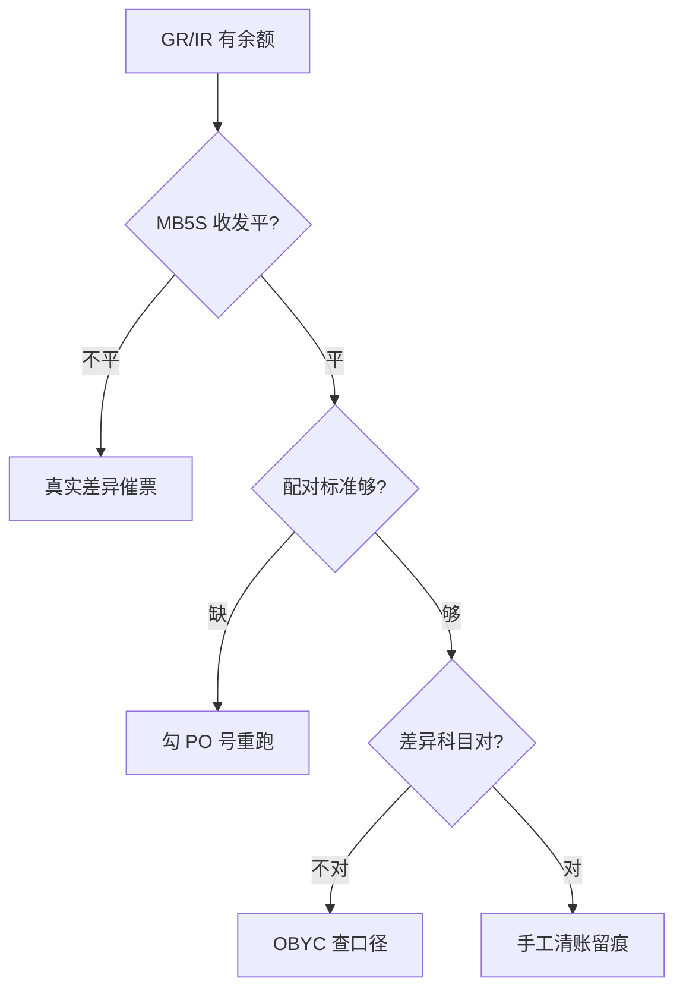

# 排查实战 02 — 月结 GR/IR 清不掉：从余额倒推清账链

> 一句话：GR/IR 清不动时，先把余额拆成「真差异」和「没配对」两堆——`MB5S` 分前者，`F.13` 测试运行分后者，两堆修法完全不同。方法论见[排查方法论](/04-troubleshooting/playbook-intro)。

## 报错现场

时间点：11 月 1 日月结日晚上。会计在 `F.13` 跑完 GR/IR 自动清账的测试运行，清单显示 **0 可清项**；`FBL3N` 一看，GR/IR 科目 191100 还有 8 万余额原封不动。这不是红条报错，是「跑了但没效果」——比报错更隐蔽，正适合用反向排查。

## 第一步：读懂消息

本例没有消息号，改读现象的措辞：测试清单为 0 可清项——程序明明执行了（日志有运行记录），但没有一对未清项满足当前清账标准。要害在「清账标准」四个字：`F.13` 只清「配得上对」的行；配不上，数量金额再平也不动。

## 第二步：圈定排查对象

- 科目范围：只看 191100，其他科目清账正常——排除月结程序整体故障。
- 余额构成：这 8 万是哪些 PO、哪些行挂出来的——圈定为「191100 未清项构成 × `F.13` 配对标准」。

## 第三步：三层排查

### 数据层

- **查什么**：`FBL3N` 拉 191100 未清项，按采购订单号汇总，逐个 PO 比对收货与开票。
- **预期**：大部分 PO 收货金额=开票金额；本例 3 个 PO 呈「收货 1000 件、开票 950 件」模式，约 7 万真实差异；另有约 1 万是数量金额都平、却没进待清清单的行。
- **异常说明什么**：收发不平是业务差异，清不掉是**应该的**；「平了却没被选中」才是技术问题——两堆混在一起，才造成「0 可清项」的假象。

### 主数据层

- **查什么**：`FS00` 查 191100 是否启用未清项管理；抽查差异 PO 的供应商（如 200001）与物料主数据。
- **预期**：未清项管理已勾选（否则根本谈不上自动清账）；发票挂对了供应商与 PO。
- **异常说明什么**：没开未清项管理，`F.13` 从一开始就无从下手；供应商串户会让配对失败。本例两者均正常，排除。

### 配置层

- **查什么一**：`F.13` 的附加清账标准——是否勾选「采购订单号」。
- **预期**：GR/IR 的收货行与发票行凭证号互不相同，靠 PO 号+行项目号配对；不勾 PO 号，平了的行也配不上。
- **异常说明什么**：本例确实没勾——那 1 万「平而未清」的根因在此。
- **查什么二**：`OBYC` 里 `WRX` 与 `PRD` 的差异口径。
- **预期**：`WRX` 指向 191100；发票价与订单价的差异应走 `PRD`，而不是全额滞留 GR/IR。
- **异常说明什么**：口径配错会让 191100 余额虚高。本例指向正确，排除。配置全链见[OBYC 笔记](/03-config-notes/mm-fi-obyc)。

## 根因（按概率）

| 根因（按概率） | 验证动作 | 修复动作 |
|---|---|---|
| 1. 真实业务差异：收货开票数量/金额不平 | `MB5S` 按 PO 比对清单 | 催票/补收货追平；差额挂账说明 |
| 2. 清账标准没勾采购订单号 | `F.13` 测试运行看已选/已清统计 | 勾选 PO 号等标准后重跑 |
| 3. 科目未启用未清项管理 | `FS00` 查控制数据 | 补设置并复核历史未清项 |
| 4. `OBYC` 差异口径错配（WRX/PRD） | `OBYC` 查规则行 | 对齐科目，复核已入账差异 |

## 真凶与修复

真凶是**数据层与配置层的复合**：约 7 万真实差异（收货 1000 件开票 950 件）+约 1 万因 `F.13` 没勾 PO 号而配不上对的行。修复三步：`MB5S` 出差异 PO 清单交采购催票；`F.13` 勾选采购订单号标准重跑，可配对部分自动清账；3 个 PO 的差额部分不硬清——挂账说明留档，按客户政策处理（口径见[GR/IR 报错条目](/01-daily-ops/errors/gr-ir-not-cleared)）。

## 修复后验证

**验证 T-Code**：`F.13`
**验证判据**：勾选 PO 号后测试运行，平账项全部进入待清清单；正式清账后 `FBL3N` 只剩 3 个差异 PO 的约 7 万，且有挂账说明
**失败对照**：仍 0 可清项 → 回 `FBL3N` 核对未清项是否都带 PO 号，无 PO 号的手工凭证按政策单独清账

## 举一反三

1. 「跑了没效果」类问题先查日志确认执行，再查选择/配对标准，别急着怀疑程序坏了。
2. GR/IR 余额先分堆：`MB5S` 分真差异，`F.13` 测试运行分配对失败——两堆修法不同，混着修会反复。
3. 差异金额异常大且集中在价格差时，上升一层查 `OBYC` 的 WRX/PRD 口径。

下一篇：[案例 03 — 月初第一笔过不了账](/04-troubleshooting/case-period)。
