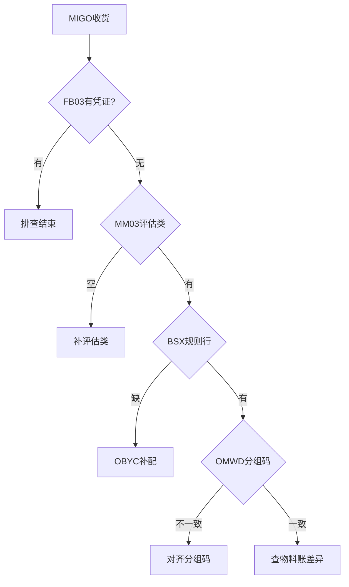

# 排查实战 04 — MIGO 收货无 FI 凭证：MM-FI 集成链反查

> 「`MIGO` 保存成功、财务却查不到账」最容易让新人慌。本案沿「评估类 → `OBYC` → 前置链」逐环反查，配置口径见 [OBYC 配置笔记](/03-config-notes/mm-fi-obyc)。

## 报错现场

周二上午 10 点，仓库在 `MIGO` 对供应商 200001 的采购订单收货 RM001 10 EA，移动类型 101，物料凭证 4900000456 保存成功，屏幕绿色提示。半小时后财务来电话：`FB03` 在公司代码 1000 按当天日期查不到会计凭证，库存科目没动静——「系统是不是漏记账了？」

刚做了什么：RM001 是上周五用 `MM01` 批量创建的新物料，今天第一次收货。这是现场唯一的特殊点。

## 第一步：读懂消息

本案的「消息」不在弹窗里：`MIGO` 成功说明 MM 侧链路通，FI 侧是静默缺凭证。回看物料凭证的消息日志，常见藏着一条黄色提示「无法为事务 BSX 确定科目」之类（示意文本，消息号以你的系统为准）。读懂这一点，方向就不是「系统坏了」，而是「科目确定链断了」。速查口径见 [MIGO 收货无 FI 凭证](/01-daily-ops/errors/migo-no-fi-doc)。

## 第二步：圈定排查对象

反查要带坐标：物料 RM001 × 工厂 1000 × 移动类型 101。集成链四环：物料凭证 → 评估类（主数据）→ `OBYC` 规则行（BSX 存货、WRX 清算）→ 前置链（`OMWD` 分组码、`OMSY` 评估区域）。从数据层往配置层走，每层先问「这一环本该输出什么」。

## 第三步：三层排查

### 数据层

**查什么**：`MB51` 输入 RM001 + 移动类型 101——物料凭证在不在、凭证环境里「会计凭证」字段、当天有没有 102 冲销。
**预期**：物料凭证在、无冲销、会计凭证字段为空。
**异常说明什么**：凭证缺失 → 问题在 `MIGO` 本身，不在集成；有冲销 → 财务查的可能是被冲销那笔；字段有号却查不到 → 看凭证是否落在别的公司代码或已归档。本例符合预期：MM 有货、FI 无账，坐实科目确定失败。

### 主数据层

**查什么**：`MM03` 查 RM001 工厂 1000 的会计 1 视图，看评估类字段。
**预期**：原材料应维护评估类 2800，能对上 `OBYC` 里 BSX 的规则行。
**异常说明什么**：评估类为空——高频真凶，确定链第一环就断；是别的值 → 命中另一套规则或直接落空。本例实测为空：批量建料时照抄了没维护评估类的参考物料。先别急着改——看配置层是否同时有缺口，一次修完。

### 配置层

**查什么**：按链逐环查：`OBYC` 双击 BSX，看评估分组码（`OMWD` 里工厂 1000 的码，如 0001）下有无 2800 的行；再看 WRX；`OMWD` 核对分组码；`OMSY` 确认评估区域与期间状态（期间问题先看 [MMPV 不能关账](/01-daily-ops/errors/mmpv-cannot-close)）。
**预期**：BSX 有 2800→140000、WRX 有 191100；`OMWD` 与 `OBYC` 两侧分组码一致。
**异常说明什么**：BSX 缺 2800 行 → 新评估类上线漏配；分组码不一致 → 规则挂在别的码下，永远匹配不上；`OMSY` 异常通常直接拦收货，不会静默缺凭证。本例：BSX 只有老评估类的行——主数据与配置是复合缺口。机制全解见 [OBYC 配置笔记](/03-config-notes/mm-fi-obyc)。

## 根因（按概率）

| 根因（按概率） | 验证动作 | 修复动作 |
|---|---|---|
| 1. 新物料评估类为空（高频） | `MM03` 会计 1 视图 | 补维护 2800；有存量库存先出清再改 |
| 2. `OBYC` BSX/WRX 缺该评估类规则 | `OBYC` 查 BSX/WRX 规则行 | 补 BSX→140000、WRX→191100 并传输 |
| 3. `OMWD` 评估分组码两侧不一致 | 对比 `OMWD` 与 `OBYC` 挂靠码 | 两边对齐同一分组码 |
| 4. S/4 物料账差异科目链没配全 | 物料账科目确定检查 | 按物料账口径补配差异科目 |

## 真凶与修复

真凶是复合缺口：RM001 评估类漏维护 + `OBYC` 没配过 2800 的 BSX/WRX 行。修复两步：`OBYC` 补 BSX→140000、WRX→191100（走传输请求）；`MM03` 给 RM001 补评估类 2800。注意：评估类只影响之后的过账，这 10 EA 已在无 FI 凭证状态下入账——库存没人动时，`MIGO` 参考物料凭证做 102 冲销后重收最干净；货已领用则按贵司口径手工补账并留档。

## 修复后验证

**验证 T-Code**：`FB03`
**验证判据**：重做一笔 101 收货，`FB03` 查到配套凭证：借 140000 存货、贷 191100 GR/IR，金额 = 10 EA × 订单单价；`MB51` 物料凭证环境里会计凭证号可见
**失败对照**：仍无 FI 凭证 → 沿 [OBYC 链路](/03-config-notes/mm-fi-obyc) 逐环复核分组码与评估类；当场弹科目缺失消息 → 按消息里的事务码回 `OBYC` 补对应规则

## 举一反三

- 「MM 有货、FI 无账」先锁坐标（物料 × 工厂 × 移动类型），再从主数据往配置走，顺序别反。
- 新物料批量上线时，把「会计视图评估类非空」加进上线检查清单，比事后排查便宜。
- 同系列排查看 [F5 开票 100 报错案](/04-troubleshooting/case-f5-100)，同样是「从消息反查配置」的打法。

