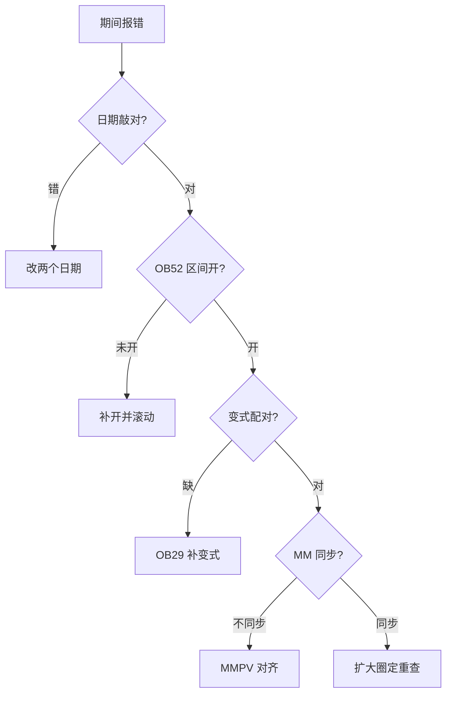

# 排查实战 03 — 月初第一笔过不了账：期间问题三层排查

> 一句话：月初第一笔报期间错，八成是 `OB52` 区间没滚动——但先用三层排查把敲错日期、变式缺失、MM 不同步各排一遍再动手。方法论见[排查方法论](/04-troubleshooting/playbook-intro)。

## 报错现场

时间点：11 月 1 日上午 8:40，月结刚结束、新月份第一笔业务。会计在 `FB50` 录凭证，过账日期 2026-11-01，保存时红条：

`Posting period 011 2026 is not open`（示意，消息号以你的系统为准）

关键背景：10 月 31 日晚同事还在正常过账。

## 第一步：读懂消息

把消息拆成三个变量：**年（2026）+ 期（011，即 11 月）+ 账户类型**。含义是「公司代码 1000 在 2026 年第 11 期没有开放的过账区间」。FI、MM、CO 各有自己的期间消息类，点长文本确认本条来自 FI；消息号以你的系统为准。关键推断：10 月底能过、11 月 1 日就报——区间大概率只开到 10 月，**没滚动**。

## 第二步：圈定排查对象

- 公司代码：确认凭证抬头的公司代码是 1000（默认值可能被改过）。
- 账户类型：本凭证是总账过账 → 账户类型 S；若是客户/供应商发票还要看 D/K。
- 收敛为：**公司代码 1000 × 2026 年 11 期 × 账户类型 S（以及兜底行「+」）**。

## 第三步：三层排查

### 数据层

- **查什么**：凭证本身的两个日期——凭证日期与过账日期。
- **预期**：都应是 2026-11-01；特别核对年份有没有敲成 2025、月份敲成 10。
- **异常说明什么**：日期敲到上期，即使开了 11 月也轮不到期间配置背锅——先改日期重试。本例日期无误，下探。速查口径见[过账期间未开](/01-daily-ops/errors/posting-period-not-open)。

### 配置层一：区间未滚动

- **查什么**：`OB52`，查公司代码 1000 所用变式在 2026 年各账户类型的开放区间。
- **预期**：11 期应对 S/D/K/A 及「+」兜底行全部开放。
- **异常说明什么**：本例区间停在 10 期——11 月没滚动，这就是报错本身。注意只开 S 不开「+」，其他账户类型的凭证会接着报错。

### 配置层二：变式缺失或错配

- **查什么**：`OB52` 首屏看变式编号；`OB29` 核对该变式的期间数与定义（12 期+特别期间），并确认公司代码挂的就是这个变式（分配入口随版本在 `OB29`/`OB37`，以你的系统为准）。
- **预期**：变式存在、期间定义与 11 月对应。
- **异常说明什么**：新公司代码常忘分配变式，年结后常缺新一年的期间。本例变式正常——排除，但它是第二概率根因，必须走到这一步才算排查完。

### 跨模块：MM 期间同步

FI 修好后别急着收工：**MM 期间与 FI 期间相互独立**。仓库 11 月第一张收货可能接着被 MM 当前期间拦住。用 `MMPV` 首屏核对 MM 当前期间是否已到 2026-11；关不开的问题见[MMPV 无法关闭](/01-daily-ops/errors/mmpv-cannot-close)。

## 根因（按概率）

| 根因（按概率） | 验证动作 | 修复动作 |
|---|---|---|
| 1. `OB52` 区间没滚动到新期间（最常见） | `OB52` 查目标年+期区间 | 补开区间，含「+」兜底行 |
| 2. 凭证/过账日期敲到上期或去年 | 回凭证看两个日期 | 改到已开期间 |
| 3. 期间变式缺失或错配 | `OB29` 查变式定义与分配 | 补定义或对齐分配 |
| 4. MM 与 FI 期间不同步 | `MMPV` 查 MM 当前期间 | `MMPV` 逐月对齐 |

## 真凶与修复

真凶在**配置层**：`OB52` 区间未滚动。修复按「开月清单」三步：`OB52` 开 11 月（全部账户类型+兜底行）；`MMPV` 把 MM 期间推进到 11 月；RACI 一句——FI 顾问负责 `OB52`，物料负责人负责 `MMPV`，按月结日历各自执行并留痕。开期间是敏感操作，按授权矩阵走审批。

## 修复后验证

**验证 T-Code**：`OB52`
**验证判据**：1000 所用变式下 2026 年 11 期对 S/D/K/A 与「+」行全部开放；原凭证重保存成功；`MMPV` 当前期间为 2026-11
**失败对照**：仍报期间错 → 核对公司代码默认值与凭证日期，再查 `OB29` 变式分配与 `MMPV` 同步状态

## 举一反三

1. 期间类报错先核对日期变量（年/期/账户类型），再动配置——敲错日期是第二大概率。
2. 修完 FI 一定顺手查 `MMPV`：MM 期间独立，不同步时收货、发票校验会连环报错。
3. 年结后首月的期间错，先怀疑「新年份+特别期间」没配，再怀疑区间滚动。

系列导航：[方法论](/04-troubleshooting/playbook-intro) · [案例 01](/04-troubleshooting/case-f5-100) · [案例 02](/04-troubleshooting/case-gr-ir)
