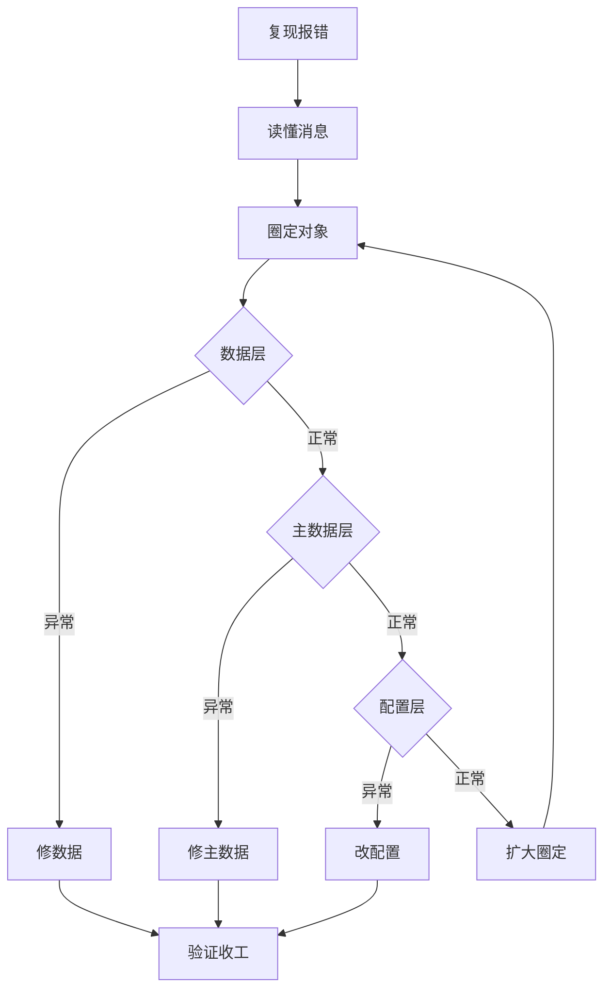

# 排查方法论 — 从报错到错误配置

> 一句话：手册其他页面是「配置→验证」的正向链路；这个系列反过来——从一条报错出发，逐层下探，直到定位那个错误配置。

## 三层排查模型

任何 FI/MM 报错，最终都能归到三层之一：

| 层 | 查什么 | 典型入口 |
|---|---|---|
| 数据层 | 这笔凭证/单据本身的数据对不对：日期、金额、科目号、数量 | `FB03`、`MB51`、原录入界面 |
| 主数据层 | 涉及的主数据状态与视图：科目、物料、客户供应商、成本中心 | `FS00`、`MM03`、`BP` |
| 配置层 | 规则与确定链：`OBYC`、`OB52`、字段状态、条件、规则 | `OBYC`、`OB52`、`OBC4` |

**永远从数据层开始，自上而下**，两个理由：

1. 检查成本递增：看一眼凭证几乎零成本，动配置要走变更、要传输、要重新验证。
2. 上层错了下层白查：凭证日期敲错一个月，把 `OB52` 翻个底朝天也修不好；先排除上层，对配置层的结论才有意义。

## 五步法

1. **复现**：让用户停在报错界面别动（截屏、记下消息），或自己照原操作跑一遍。复现不了的报错先不修。
2. **读懂消息**：拿到「消息类 + 消息号 + 参数」，弄清系统在抱怨哪个对象（见下方工具箱）。
3. **圈定对象**：把问题缩小到「哪个公司代码 × 哪个科目/物料/供应商 × 哪个期间」。
4. **逐层排查**：按三层模型下探，每层动手前先回答三句——查什么、预期看到什么、异常说明什么。
5. **修复后验证**：跑判据确认（不只看红条消失），一次只改一处，改动留痕。

## 消息诊断工具箱

| 工具 | 什么时候用 | 能看到什么 |
|---|---|---|
| 消息长文本按钮 | 屏幕底部任何红条/黄条 | 参数替换后的完整说明，常直接点破缺什么 |
| `SE91` | 拿到「类+号」（如 `F5 100`） | 官方文档：含义、参数占位、触发场景 |
| `F1`/`F4` | 字段行为可疑（不让输、不出现） | 字段帮助、可选值清单及其配置来源 |
| `ST22` | 直接弹「运行时错误/终止」 | ABAP 短转储：出错程序、行号、关键变量 |
| `SM35` | 批输入/批量导入卡住 | 会话日志：卡在哪一屏、哪个字段、什么值 |
| `SU53` | 怀疑权限不足 | 最近一次授权检查失败，缺哪个授权对象 |
| `SLG1` | 后台作业「跑了但没生效」 | 应用日志：程序自己记下的处理明细 |

## 排查看什么，先问三句

用户给你的往往只有「系统报错了」。问诊三句把现场钉死：

1. **谁的凭证、哪张单**——要凭证号/单据号，落实公司代码与用户，不接受转述。
2. **哪一步报的**——回车、保存还是后台作业？报错点离配置的远近决定排查起点。
3. **报错前最后一个成功动作**——上个月好用这个月报错，多为期间/滚动类；从来没成功过，多为配置缺失类。

## 三个案例

| 案例 | 报错现场 | 真凶所在层 |
|---|---|---|
| [01 — F5 100 科目不存在](/04-troubleshooting/case-f5-100) | `FB50` 录凭证报 G/L account 400000 不存在（示意） | 主数据层 |
| [02 — GR/IR 清不掉](/04-troubleshooting/case-gr-ir) | 月结 `F.13` 跑完余额 8 万不动 | 数据+配置复合 |
| [03 — 月初第一笔过不了账](/04-troubleshooting/case-period) | `Posting period 011 2026 not open`（示意） | 配置层 |

每个案例按同一结构走：现场→读消息→圈定→三层排查→真凶→修复验证→举一反三。读完这条链，再回[报错速查](/01-daily-ops/errors/)当索引用；两版行为差异查[版本差异总表](/00-about/version-matrix)；工具速查看[T-Code 卡片](/01-daily-ops/tcode-cards)。
