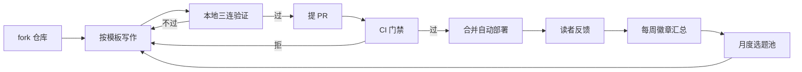

# 如何贡献内容

贡献有三档，按你能投入的时间选：**点按钮反馈 30 秒**（页面底部「有用 / 有误」按钮，零门槛）、**报勘误 2 分钟**（带版本与现象提 Issue）、**写一页 30 分钟**（用下面的模板，复制即用）。

选题不靠拍脑袋：GoatCounter 搜索无结果的高频词、`error` Issue 集中的页面优先写、优先修；访问量最低的页面每月评估合并或下架。你反馈得越具体，被选中越快。

## 贡献与反馈闭环

写作只是环上一段，读者反馈经徽章汇总回流到选题池，形成闭环：



## 环境准备

```bash
git clone https://github.com/seecrazy/fico-field-guide.git
cd fico-field-guide
npm install
npm run dev
```

本地预览地址：`http://localhost:5173` 。改动保存即热更，Mermaid 图直接渲染，写完看一眼再提交。

## 写作硬规则

`docs/03-config-notes/` 与 `docs/01-daily-ops/errors/` 下的页面（含单文件形态的 `error-cookbook.md`）受 CI 硬校验，`npm run check` 会机器拒绝不合规内容。三条规则，字符要求精确到标点：

1. **验证三元组**：正文必须逐字含三行——`**验证 T-Code**：`、`**验证判据**：`、`**失败对照**：`（冒号用全角，CI 按子串匹配）。
2. **验证日期与环境**：frontmatter 必须有 `verifiedOn`（真实日历日期，`2026-02-30` 会被拒）与 `verifiedEnv`。
3. **根因排序表**：报错类页面必须有表头含「根因（按概率）」的表格，按概率降序排，不写「可能的原因」。

三个要求在下面模板里都已放好位置，照抄改内容即可，不要删骨架行。

## 三个模板

### 模板 A：配置笔记（放 `docs/03-config-notes/`）

````markdown
---
title: <主题> — <一句话副题>
version: [ECC, S/4HANA]
module: FI-GL
difficulty: 中
verifiedOn: 2026-11-11
verifiedEnv: "SAP 标准行为（ECC 6.0 / S/4HANA 2023），示例公司代码 1000"
tcodes: [<本页涉及的事务码>]
---

> **一句话结论**：……（10 秒决定去留）

## 为什么要配 / 配错会怎样
……

## 配置步骤
1. ……

## 怎么验证

**验证 T-Code**：`FB03`
**验证判据**：执行后 XX 科目余额应为 0
**失败对照**：若余额不为 0，检查 YY 是否已执行

## 常见配错（按概率）

| 根因（按概率） | 验证动作 | 修复动作 |
|---|---|---|
| 1. …… | …… | …… |
````

### 模板 B：报错条目（放 `docs/01-daily-ops/errors/`）

````markdown
---
title: "<消息文本>（消息号 <类 空格 号>，以你的系统为准）"
severity: 高频
module: FI-GL
verifiedOn: 2026-11-11
verifiedEnv: "SAP 标准行为（ECC 6.0 / S/4HANA 2023），示例公司代码 1000"
tcodes: [FB50]
---

> **一句话结论**：……

## 报错现象
……

## 根因排查（按概率）

| 根因（按概率） | 验证动作 | 修复动作 |
|---|---|---|
| 1. …… | …… | …… |

**验证 T-Code**：`FB03`
**验证判据**：……
**失败对照**：……
````

### 模板 C：T-Code 卡片（加进 `docs/01-daily-ops/tcode-cards.md`）

````markdown
### `FB50` — 总账凭证过账

- **用途**：……
- **前置条件**：……
- **操作要点**：……
- **验证判据**：……
````

## 提交流程

```bash
git checkout -b feat/my-topic     # 1. 建分支
# 2. 按模板写内容
npm run check && npm test && npm run docs:build   # 3. 本地全过再提交
# 4. push 后开 PR
```

PR 触发 CI（`quality.yml`）：结构检查、单元测试、构建冒烟、gitleaks 密钥扫描，任一失败都会拦截。合并进 `main` 后 `deploy.yml` 自动构建部署——部署前还会再跑一遍 check 与 test，不合规内容上不了线。

## 反馈按钮说明

- **👍 这页解决了我的问题**（`useful`）：纯计数，无需任何说明，每周一 `badges.yml` 自动汇成页面徽章「✅ N 人标记有用」。
- **🐞 这页有误 / 过时**（`error`）：必须填**系统版本**与**实际现象**才会被处理——没有版本和现象的勘误无从验证；处理关闭后「⚠️ 有未处理勘误」徽章随之消失。
- **📝 希望增加内容**（`content-request`）：进月度选题池，与搜索无结果词、error 集中页共同排序。

## 约定速查

| 场景 | 约定 |
|---|---|
| 公司代码 / 工厂 / 成本中心 | 一律 `1000`，不出现真实客户编号 |
| 客户 / 供应商 | 明显示例号 `客户 100001`、`供应商 200001` |
| T-Code 与消息号 | 行内代码：\`FB50\`、\`F5 100\` |
| 金额与日期 | `1,000.00 USD`、`YYYY-MM-DD` |

frontmatter 只支持标量与行内数组（如 `tcodes: [FB50, FB03]`），不要写嵌套结构。常用字段：`title`、`verifiedOn`、`verifiedEnv` 必填；配置笔记另有 `version`、`module`、`difficulty`；报错页有 `severity`。完整规范见[写作约定页](/00-about/conventions)。
