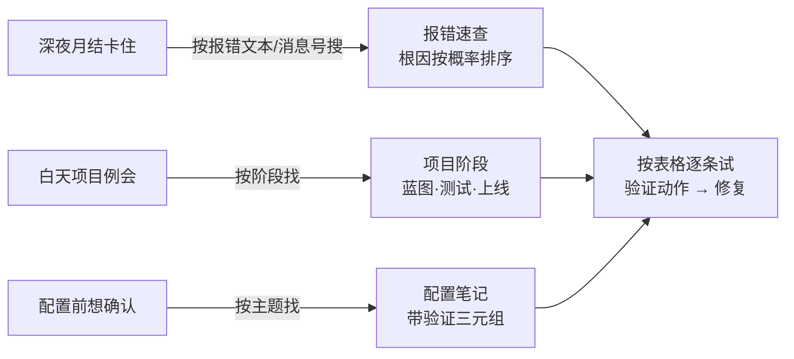

## 三类读者，三条路径

- **运维型读者**（卡在报错上）：进 [报错速查](/01-daily-ops/errors/)，按消息号或现象找条目，从根因表第一行开始试。
- **项目型读者**（在蓝图/测试/切换阶段）：进 [项目阶段](/02-project/blueprint-questions)，直接取清单与模板。
- **配置型读者**（动手前先确认）：进 [配置笔记](/03-config-notes/mm-fi-obyc)，先读「一句话结论」和「配错会怎样」，再决定要不要继续。

## 这本手册不承诺什么

它不承诺「内容绝对正确」——它承诺**每篇都给验证方法**，你跑一遍就能知道对错；写错了，30 秒内会被你发现（[三条硬规则](/00-about/conventions)）。SAP 版本差异客观存在，所有内容请以你自己的系统实测为准。
